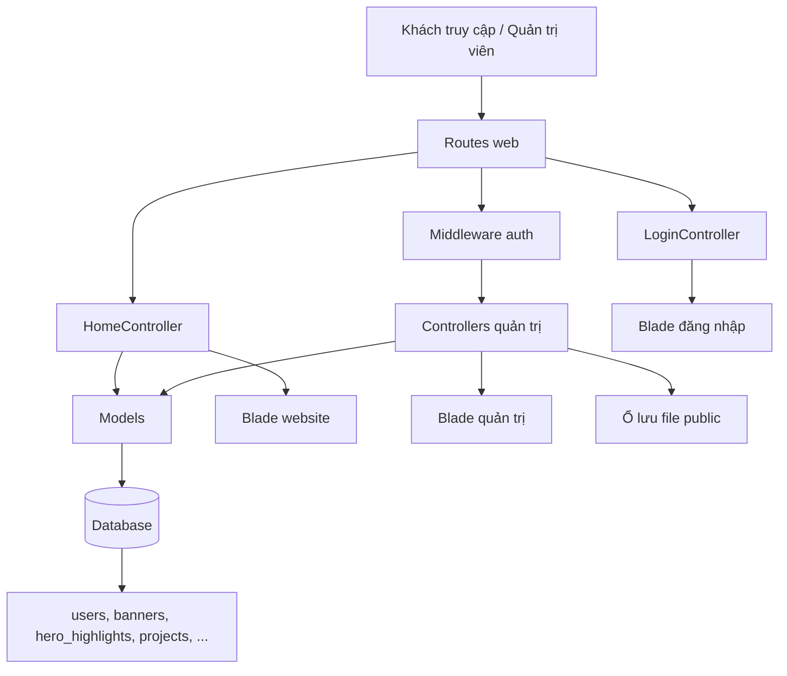

# 1. Tổng quan hệ thống

## Paneco đang gồm những phần nào?

| Phân hệ | Vai trò | Phụ thuộc chính | Trạng thái quan sát được |
|---|---|---|---|
| Website công khai | Giới thiệu doanh nghiệp, dịch vụ, dự án và liên hệ | Route `/`, `HomeController`, Blade, một phần dữ liệu database | Trang có layout lớn; chỉ banner và điểm nổi bật được truy vấn động. Nhiều mục còn tĩnh hoặc bị comment. |
| Đăng nhập | Tạo phiên đăng nhập cho người quản trị | `users`, session Laravel, `LoginController` | Có form, xác thực email/mật khẩu, ghi nhớ đăng nhập, giới hạn thử và đăng xuất. Chưa kiểm tra thao tác thực tế. |
| Quản trị banner | Thêm, sửa, xóa, bật/tắt và sắp thứ tự banner | `banners`, controller, form, public storage | Có đủ các thao tác trong code; hiển thị ảnh ở trang chủ có dấu hiệu lỗi CSS. |
| Quản trị điểm nổi bật | Quản lý icon/tiêu đề/phụ đề ở trang chủ | `hero_highlights`, controller và view | Có các thao tác quản trị; bộ lọc active được dùng ở trang chủ. Chưa xác minh bằng trình duyệt. |
| Quản trị dự án | Dự kiến quản lý công trình thép/BIM | `projects`, `ProjectController`, view dự án | Có route và form nhưng tên trường không khớp schema, tên route trong view sai. Không nên xem là hoạt động ổn định. |
| Quản trị thông tin công ty | Dự kiến cập nhật tên, MST, liên hệ, tầm nhìn/sứ mệnh | `company_infos`, controller và view | Có bảng và một phần controller; view gần như trống, các route CRUD khác thiếu phương thức xử lý. |
| Các nội dung còn lại | Giá trị cốt lõi, văn phòng, dịch vụ, phần mềm, nhân sự, tuyển dụng, tin, đối tác, liên hệ | Các bảng/model tương ứng | Mới có phần cấu trúc database và model rỗng; chưa thấy luồng CRUD. Một số nội dung trang chủ đang viết tĩnh hoặc bị comment. |
| Hạ tầng Laravel | Lưu phiên, cache, hàng đợi, log và file | MySQL/SQLite theo `.env`, cấu hình Laravel | Có cấu hình và migration framework; chưa thấy job/queue nghiệp vụ cụ thể. |

## Sơ đồ phụ thuộc

## Người dùng và quyền

- Khách truy cập được vào trang `/` và `/login`.
- Sau khi đăng nhập, middleware `auth` cho phép vào các route nằm dưới `/admin`.
- Code hiện tại không phân biệt vai trò (ví dụ chủ hệ thống, biên tập viên); tài khoản đã đăng nhập có cùng quyền trên các route quản trị.
- Không thấy màn hình tạo/quản lý tài khoản. Seeder tạo/cập nhật một tài khoản nếu đủ ba biến `ADMIN_NAME`, `ADMIN_EMAIL`, `ADMIN_PASSWORD`; nếu thiếu thì không tạo user.

## Bản đồ công nghệ cho người quản lý

- **Laravel 13 / PHP 8.3**: bộ khung xử lý yêu cầu website.
- **Blade**: các file giao diện `.blade.php`.
- **Eloquent**: lớp Model giúp code đọc/ghi bảng dữ liệu.
- **MySQL hoặc SQLite**: kết nối do `.env` quyết định; `.env.example` mặc định SQLite. Không chia sẻ nội dung bí mật của `.env`.
- **Storage public**: ảnh banner được lưu theo thư mục `banners` trên ổ public.
- **Bootstrap, Tailwind CDN, Font Awesome, Google Fonts và ảnh Unsplash**: được gọi trực tiếp trong giao diện; giao diện phụ thuộc internet và dịch vụ ngoài.
- `resources/css/app.css`, `resources/js/app.js` và Vite có trong dự án nhưng các trang chính đang chứa phần lớn CSS/JS trực tiếp trong Blade.

## Cách quản lý thay đổi an toàn

Trước khi yêu cầu thay đổi một nội dung, hãy xác định nó là dữ liệu trong trang quản trị, dữ liệu tĩnh trong Blade hay dữ liệu do Laravel lấy từ database. Với thay đổi ảnh/banner, kiểm tra cả file trong storage lẫn đường dẫn hiển thị. Với thay đổi database, yêu cầu người thực hiện nêu rõ bảng/cột và ảnh hưởng tới màn hình liên quan trước khi áp dụng.
