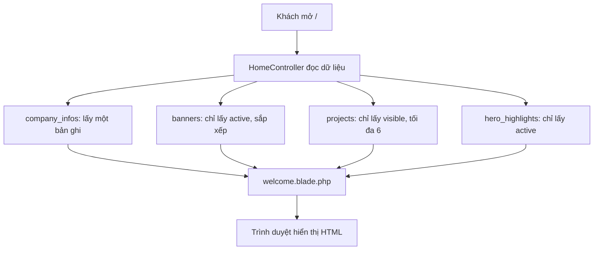
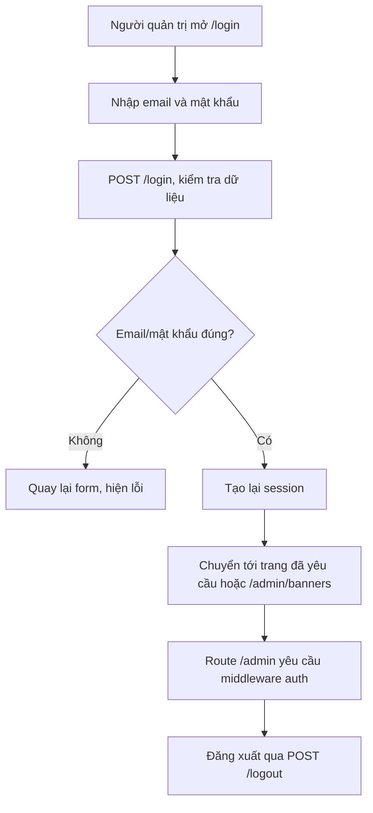
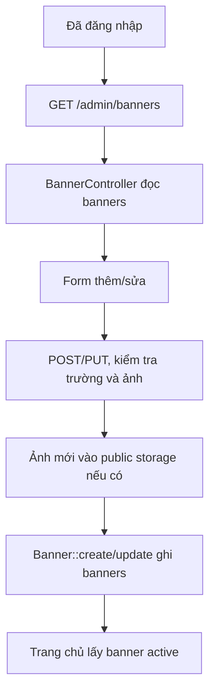
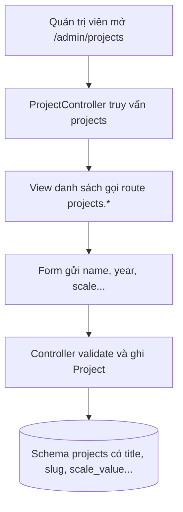

# 3. Các luồng nghiệp vụ

## A. Khách xem trang chủ

**Điều kiện/ngoại lệ:** nếu không có banner active thì khối hero bị bỏ qua; không có điểm nổi bật active thì khu vực này không xuất hiện. Dù controller lấy công ty và dự án, view hiện dùng nội dung tĩnh ở nhiều khu vực và không dùng danh sách `$featuredProjects`. Ảnh nền banner có chuỗi CSS đáng ngờ; cần xem thực tế trên trình duyệt để xác nhận lỗi hiển thị.

## B. Người quản trị đăng nhập

**Điều kiện/ngoại lệ:** yêu cầu email hợp lệ và mật khẩu; route đăng nhập có giới hạn `5` lần trong `1` phút theo middleware Laravel; ô “ghi nhớ đăng nhập” gửi tùy chọn remember. Không có chức năng quên mật khẩu trong route. Chưa có quyền theo vai trò, nên middleware chỉ hỏi “đã đăng nhập chưa?”.

## C. Quản lý banner (luồng được nối tương đối đầy đủ)

**Các nhánh:** sửa banner mà không tải ảnh mới thì giữ ảnh cũ; xóa banner thì code xóa ảnh public nếu file tồn tại rồi xóa bản ghi; `is_active` lấy từ checkbox, `sort_order` mặc định 0. Nếu form không gửi hợp lệ, Laravel trả lỗi validation. Việc hiện ảnh nền ở website vẫn cần xác minh vì CSS trong view có lỗi nghi ngờ.

## D. Quản lý điểm nổi bật

1. Quản trị viên mở `/admin/hero-highlights`.
2. Controller đọc danh sách từ `hero_highlights`.
3. Form gửi icon, title, subtitle, thứ tự và trạng thái active.
4. Controller xác thực, tạo/cập nhật/xóa bản ghi.
5. Trang chủ lấy các bản ghi active và hiển thị icon, tiêu đề, phụ đề.

**Ngoại lệ:** `icon` và `title` bắt buộc; thứ tự mặc định 0; checkbox không chọn được chuyển thành false. Không có kiểm soát để giới hạn ai được sửa ngoài yêu cầu đăng nhập.

## E. Dự án – luồng dự kiến và điểm đứt

Luồng không khớp ở nhiều điểm: form gọi tên route `projects.*` trong khi khai báo route sinh `admin.projects.*`; form/controller/model gửi `name`, `scale`, `image` trong khi migration khai báo `title`, `scale_value`, `scale_unit`, `thumbnail`; controller redirect cũng gọi route không có tiền tố. Do đó không thể coi tạo/sửa/xóa dự án là dùng được cho tới khi được sửa và kiểm thử.

## F. Thông tin công ty – luồng chưa khép kín

- `/admin/info` gọi `CompanyInfoController@index`, lấy dòng đầu hoặc tạo object rỗng và trả view `admin.info.index`.
- View này không chứa form nhập thông tin trong source đã kiểm tra.
- Controller có xử lý `update` và lưu bản ghi đầu tiên vào `company_infos`, nhưng không thấy đường form vận hành nối tới nó.
- Resource routes còn tạo `create/store/show/edit/destroy`; controller không có các phương thức này. Các view `info/create` và `info/edit` đang chứa form dự án, không phải form công ty.
- Các thông tin công ty trên trang công khai phần lớn là nội dung viết cứng.

## G. Liên hệ, ứng tuyển, tin tức và nội dung khác

Form liên hệ trong `welcome.blade.php` nằm trong HTML comment; không có route tiếp nhận POST. Vì vậy chưa có bước xác thực, controller, lưu bảng `contacts`, thông báo email hay kết quả cho người gửi. Phần tuyển dụng/tin/đối tác trong trang chủ cũng bị comment; không có luồng CRUD dù một số bảng đã được khai báo.

## H. Tạo tài khoản quản trị

Seeder chỉ chạy `User::updateOrCreate` khi cả ba cấu hình `ADMIN_NAME`, `ADMIN_EMAIL`, `ADMIN_PASSWORD` đều có giá trị. Mật khẩu được băm trước khi lưu. Nếu thiếu một trong ba biến, seeder không tạo user. Không có route đăng ký công khai hoặc giao diện quản lý tài khoản. Nội dung dữ liệu hiện có trong bảng `users` chưa được kiểm tra.
