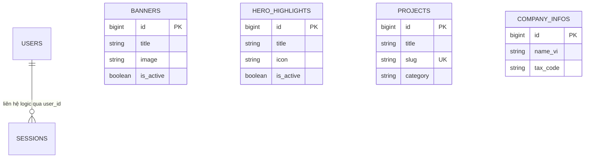

# 4. Bản đồ database

Migrations mô tả **21 bảng ứng dụng/hạ tầng**, cộng bảng `migrations` mà Laravel dùng để ghi nhận lịch sử migration. Các migration hiện có đều báo trạng thái đã chạy. Điều đó xác nhận schema đã được áp dụng trên kết nối hiện tại, nhưng không chứng minh bảng đang có dữ liệu nghiệp vụ.

## Các bảng nghiệp vụ

| Bảng | Ý nghĩa và các trường đáng chú ý | Được dùng bởi / trạng thái |
|---|---|---|
| `company_infos` | Thông tin doanh nghiệp: `name_vi`, `name_en`, mã số thuế, ngày thành lập, vốn, đại diện, điện thoại, email, slogan, greeting, vision, mission, logo, ảnh giới thiệu, Zalo | `CompanyInfo` và `CompanyInfoController`; trang chủ hiện không dùng dữ liệu này một cách rõ ràng; admin chưa có form hữu dụng. |
| `banners` | Banner trang chủ: nhãn, tiêu đề, mô tả, đường dẫn ảnh, hai cặp nội dung/nút, thứ tự, `is_active` | `BannerController`, `Banner`, `welcome`; có CRUD trong code. |
| `hero_highlights` | Các điểm nổi bật: icon, title, subtitle, thứ tự, active | `HeroHighlightController`, `HeroHighlight`, `welcome`; có CRUD trong code. |
| `projects` | Dự án: `title`, `slug` unique, category `steel/bim`, năm, quy mô số và đơn vị, chi tiết, software, mô tả, thumbnail, featured, visible | Có Model/controller/view và truy vấn trang chủ; **tên trường không thống nhất** giữa schema và phần quản trị. |
| `services` | Dịch vụ: title, description, icon, thứ tự | Migration/model có; nội dung công khai đang tĩnh; chưa có quản trị. |
| `softwares` | Phần mềm: name, vendor, category, thứ tự | Migration/model có; danh sách công khai đang tĩnh; chưa có quản trị. |
| `core_values` | Giá trị cốt lõi: title, description, icon, thứ tự | Migration/model có; trang chủ dùng bảng khác `hero_highlights`; chưa thấy CRUD. |
| `offices` | Văn phòng: name, address, thứ tự | Migration/model có; địa chỉ công khai đang tĩnh; chưa thấy CRUD. |
| `employees` | Nhân sự: tên, chức vụ, phòng ban, kinh nghiệm, kỹ năng, bio, ảnh, thứ tự, visible | Migration/model có; chưa có route/controller/view. |
| `recruitments` | Vị trí tuyển dụng: title, location, số lượng, mô tả, yêu cầu, deadline, active | Migration/model có; khu tuyển dụng public bị comment; chưa có CRUD. |
| `news` | Tin: title, slug unique, category, summary/content, thumbnail, ngày đăng, visible | Migration/model có; khu tin public bị comment; chưa có CRUD. |
| `partners` | Đối tác: name, logo, website, thứ tự | Migration/model có; khu đối tác bị comment; chưa có CRUD. |
| `contacts` | Tin liên hệ: tên, điện thoại, email, mục đích, message, `is_read` | Migration/model có; form bị comment và không có endpoint ghi nhận. |

## Các bảng nền tảng Laravel

| Bảng | Vai trò |
|---|---|
| `users` | Tài khoản đăng nhập: tên, email duy nhất, password hash, email verified, remember token, timestamps. |
| `password_reset_tokens` | Lưu token đặt lại mật khẩu. Bảng có nhưng chưa có luồng quên mật khẩu. |
| `sessions` | Lưu phiên đăng nhập khi session driver là database; có session ID, user ID nullable, IP, trình duyệt, payload, thời điểm hoạt động. |
| `cache`, `cache_locks` | Cache và khóa cache khi cấu hình dùng database. |
| `jobs` | Việc chờ xử lý nền. Chưa thấy nghiệp vụ trong dự án sử dụng queue cụ thể. |
| `job_batches` | Thông tin nhóm việc nền. |
| `failed_jobs` | Ghi việc nền bị lỗi. |
| `migrations` | Laravel tự tạo để ghi tên migration và batch đã chạy; không phải bảng nội dung website. |

## Quan hệ giữa bảng

Các bảng nội dung chính hiện đứng độc lập trong migration: không khai báo khóa ngoại nối project với công ty, tin với tác giả, tuyển dụng với ứng viên hoặc contact với user. `sessions.user_id` có index nhưng migration không khai báo `constrained()`; sơ đồ trên chỉ là quan hệ logic, không phải ràng buộc database. `users.email`, `projects.slug`, `news.slug` có unique theo migration.

## Bảng nào phục vụ luồng nào?

- Trang chủ truy vấn `company_infos`, `banners`, `projects`, `hero_highlights` trong `HomeController`; view chỉ dùng trực tiếp banner/điểm nổi bật. Dự án và thông tin công ty được lấy nhưng không được hiển thị từ biến tương ứng trong phần Blade đang hoạt động.
- Quản trị banner đọc/ghi `banners` và lưu file banner vào storage public.
- Quản trị điểm nổi bật đọc/ghi `hero_highlights`.
- Quản trị dự án nhắm tới `projects`, nhưng tên cột model/controller không khớp bảng.
- Đăng nhập dùng `users`; phiên dùng `sessions` nếu môi trường đặt `SESSION_DRIVER=database`.
- Các bảng dịch vụ, phần mềm, nhân sự, văn phòng, giá trị cốt lõi, tuyển dụng, tin, đối tác và liên hệ chưa có quy trình quản lý nối end-to-end.

## Cảnh báo khi thay đổi dữ liệu

Không sửa trực tiếp tên cột hoặc xóa bảng để khắc phục lỗi dự án trước khi người phụ trách kỹ thuật lập kế hoạch migration và sao lưu. Chênh lệch giữa model/form với schema cần được giải quyết có chủ đích: đổi code theo schema hiện hành hoặc thiết kế migration mới sau khi xác nhận dữ liệu và mong muốn nghiệp vụ.
