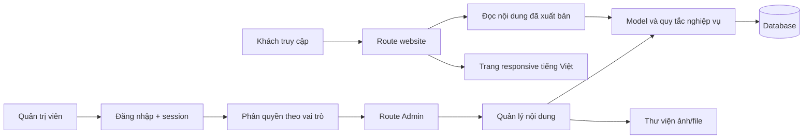

# Tổng quan hệ thống Paneco

Tài liệu này dùng tên file theo bộ hồ sơ quản lý. Phân tích chi tiết: [01-tong-quan.md](01-tong-quan.md), [05-ban-do-code.md](05-ban-do-code.md).

## Hiện trạng đã kiểm kê

Ứng dụng là Laravel 13/PHP 8.3. Luồng web chính gồm trang chủ (`HomeController`), đăng nhập (`LoginController`) và một khu Admin được bảo vệ bởi middleware `auth`. Các nhóm quản trị có code cho Banner, điểm nổi bật trang chủ, Dự án và một phần Thông tin công ty. Database có thêm bảng cho dịch vụ, phần mềm, tuyển dụng, tin tức, đối tác, nhân sự, văn phòng, liên hệ và giá trị cốt lõi; chưa thấy các luồng quản lý đầy đủ cho các nhóm này.

## Định vị nghiệp vụ đã được chủ dự án xác nhận

Paneco là công ty ở Việt Nam nhận dự án từ Nhật Bản và triển khai bản vẽ Shop Drawing/bản vẽ chi tiết gia công dựa trên tài liệu thiết kế của dự án. Website trước mắt chỉ dùng tiếng Việt. Chi tiết năng lực, công cụ/phần mềm, quy trình kiểm tra, khách hàng và số liệu dự án phải lấy từ Paneco xác nhận; không suy diễn từ website tham khảo.

NAP-VN được dùng làm tham khảo về cấu trúc: lời giới thiệu năng lực, trang riêng về lĩnh vực kinh doanh, hồ sơ công ty, danh mục dự án phân theo thời gian/loại bản vẽ, nhân sự và tuyển dụng. Xem [bản đề xuất cho sếp](DE_XUAT_TRINH_SEP.md) và các link nguồn ở [lộ trình](DEVELOPMENT_ROADMAP.md).

## Kiến trúc đề xuất (chưa triển khai)

## Nguyên tắc kiến trúc đề nghị

1. Giữ Laravel và cấu trúc MVC đang có; không viết lại ứng dụng từ đầu.
2. Mỗi loại nội dung có một nguồn dữ liệu rõ ràng; tránh một nửa viết trong Blade và một nửa trong database.
3. Dùng cùng một hợp đồng dữ liệu từ form → validation → controller → model → bảng → giao diện public.
4. Xây xác thực và quyền ở backend. Chỉ đăng nhập không đồng nghĩa có quyền thực hiện mọi thao tác.
5. Dùng media/storage có quy tắc cho upload; giữ đường dẫn file cùng cơ chế sao lưu.
6. Thiết kế tiếng Việt làm ngôn ngữ mặc định; để ngỏ cấu trúc bản dịch tiếng Anh nhưng chỉ triển khai khi được duyệt.
7. Tách dữ liệu cài đặt, menu và SEO thành cấu trúc quản trị có kiểm soát; không biến mọi thứ thành một bảng key/value nếu cần quan hệ hoặc lịch sử.

## Các nguyên tắc chưa chốt

Mô hình trường dự án; có cần nhiều ngôn ngữ ngay không; vai trò quản trị nào cần có; ai nhận/xử lý yêu cầu liên hệ; nội dung nào bắt buộc phải động; cách lưu SEO/menu/cấu hình; và môi trường triển khai thực tế. Xem [DEVELOPMENT_ROADMAP.md](DEVELOPMENT_ROADMAP.md).
